# 🛍️ Fashion Retail Marketing ROI & Sales Performance Analytics

[](https://powerbi.microsoft.com/)
[](https://learn.microsoft.com/en-us/dax/)
[](https://learn.microsoft.com/en-us/power-bi/guidance/star-schema)
[]()
[]()

> **An enterprise-grade tactical Business Intelligence solution engineered to bridge the strategic gap between digital marketing expenditure and POS retail transaction revenue, optimize Return on Ad Spend (ROAS), eliminate ad budget waste, and empower C-suite growth decision-making.**

---

## 📌 Table of Contents
1. [Background & Business Context](#-1-background--business-context)
   - [1.1 Executive Overview & Business Landscape](#11-executive-overview--business-landscape)
   - [1.2 Key Headline Results & Performance Scale](#12-key-headline-results--performance-scale)
   - [1.3 Core Business Questions Answered](#13-core-business-questions-answered)
2. [Design Thinking Process](#-2-design-thinking-process)
   - [Stage 1: Empathize — Stakeholder Discovery & Context](#stage-1-empathize--stakeholder-discovery--context)
   - [Stage 2: Define Point of View (POV) — Dual Northstars & Growth Formula](#stage-2-define-point-of-view-pov--dual-northstars--growth-formula)
   - [Stage 3: Ideate — 3-Layer Information Architecture & Layout](#stage-3-ideate--3-layer-information-architecture--layout)
   - [Stage 4: Prototype — Visual Selection Matrix & Wireframing](#stage-4-prototype--visual-selection-matrix--wireframing)
   - [Stage 5: Review & Iterate — Usability Testing & Refinements](#stage-5-review--iterate--usability-testing--refinements)
3. [Data Architecture & Modeling](#-3-data-architecture--modeling)
   - [3.1 Data Pipeline & ETL Transformation](#31-data-pipeline--etl-transformation)
   - [3.2 Kimball Star Schema Architecture](#32-kimball-star-schema-architecture)
   - [3.3 Table Summary & Grain Specifications](#33-table-summary--grain-specifications)
   - [3.4 Comprehensive Data Dictionary](#34-comprehensive-data-dictionary)
4. [Interactive Dashboard Architecture & Visuals](#-4-interactive-dashboard-architecture--visuals)
   - [Page 1: Executive Overview](#page-1-executive-overview)
   - [Page 2: Campaign Performance Analysis](#page-2-campaign-performance-analysis)
   - [Page 3: Product & Merchandising Analysis](#page-3-product--merchandising-analysis)
   - [Page 4: Strategic Insights & Recommendations](#page-4-strategic-insights--recommendations)
   - [Micro-Interactions & Report-Page Tooltips](#micro-interactions--report-page-tooltips)
5. [In-Depth Business Insights & Evidence](#-5-in-depth-business-insights--evidence)
   - [Insight 1: Marketing is the Primary Growth Engine with High Capital Efficiency](#insight-1-marketing-is-the-primary-growth-engine-with-high-capital-efficiency)
   - [Insight 2: Severe Revenue Concentration in a Small Basket of "Hero SKUs"](#insight-2-severe-revenue-concentration-in-a-small-basket-of-hero-skus)
   - [Insight 3: Capital Allocation Mismatch — High-ROAS Underfunded vs Over-Budget Bleeders](#insight-3-capital-allocation-mismatch--high-roas-underfunded-vs-over-budget-bleeders)
   - [Insight 4: Significant Scalable Headroom in Prospecting Acquisition Funnels](#insight-4-significant-scalable-headroom-in-prospecting-acquisition-funnels)
6. [Prioritized Strategic Action Matrix](#-6-prioritized-strategic-action-matrix)
7. [Advanced DAX Formula Engineering](#-7-advanced-dax-formula-engineering)
8. [Repository Structure & How to Reproduce](#-8-repository-structure--how-to-reproduce)
9. [Author & Contact](#-9-author--contact)

---

## 🏢 1. Background & Business Context

### 1.1 Executive Overview & Business Landscape
In modern multichannel fashion retail and e-commerce, digital advertising serves as the principal growth lever. However, fashion retail leadership consistently faces a critical operational blind spot: **marketing ad expenditure and point-of-sale (POS) transactional receipts reside in completely disconnected data silos**. 

Ad managers optimize campaigns based on vanity front-end metrics (Impressions, Clicks, CTR, Cost per Message), while retail merchandisers and sales directors track rear-view gross turnover, discounting, and inventory stockouts. Without end-to-end attribution linking paid ad campaigns to SKU-level cash receipts, leadership cannot objectively verify:
* Which specific advertising campaigns drive actual commercial revenue versus burning budget.
* Which apparel categories and SKUs justify heavy promotional ad spend versus those sustained by organic customer pull.
* How to dynamically adjust ad spend pacing week-over-week (WoW) to protect bottom-line operating margins.

This project delivers a **full-funnel Business Intelligence Control Tower** designed specifically for the **Senior Marketing Manager** and **Sales Director**. Spanning May 2024 transactional operations across 2,858 successful orders, 3,451 order lines, and 1,000+ daily campaign performance logs, this dashboard unifies the conversion journey from **Impression $\rightarrow$ Click $\rightarrow$ Message $\rightarrow$ Completed Purchase**.

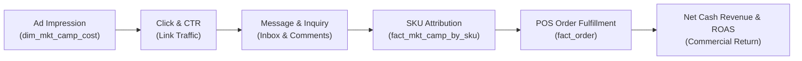

---

### 1.2 Key Headline Results & Performance Scale

| Metric Category | Performance Indicator | Benchmark / Scale | Analytical Interpretation |
| :--- | :---: | :---: | :--- |
| **Gross Turnover** | **4.77 Billion VND** | 2,858 Total Orders (3,451 Lines) | Robust commercial baseline across 300+ active apparel SKUs. |
| **Marketing Revenue** | **3.02 Billion VND** | **63.3%** of Total Company Sales | Digital advertising is the dominant commercial revenue driver. |
| **Digital Ad Spend** | **394 Million VND** | Month of May 2024 | Tightly managed spend across 100+ active ad variations. |
| **Blended ROAS** | **7.67x** | Target Benchmark: > 4.0x | Outstanding capital efficiency yielding 7.67 VND for every 1 VND spent. |
| **Direct / Organic Sales** | **1.75 Billion VND** | **36.7%** of Total Company Sales | Organic customer retention, direct store traffic, and repeat VIP buyers. |
| **Revenue Concentration** | **Top 3 Campaigns = ~715M VND** | Audrey Shirt, Lisa Dress, Avian Dress | Over 23.7% of total marketing revenue originates from just 3 ad sets. |

---

### 1.3 Core Business Questions Answered
1. **Capital Allocation & Pacing:** Is digital marketing ad expenditure being deployed effectively across weeks and campaign types, or are budgets prematurely exhausted on underperforming sets?
2. **Attribution & Financial Return:** Does digital advertising deliver sales revenue commensurate with expenditure (ROAS), and what is paid marketing's true contribution to total company turnover?
3. **Merchandising & SKU Performance:** Which specific apparel categories (Dresses, Shirts, Pants) and hero SKUs deliver superior capital productivity versus draining promotional budgets?
4. **Growth Strategy & Risk Mitigation:** How can budget reallocation unlock incremental revenue while insulating the business from heavy single-SKU dependency and creative ad fatigue?

---

## 🧠 2. Design Thinking Process

To ensure the Business Intelligence solution solves authentic operational bottlenecks rather than producing decorative vanity charts, development adhered strictly to the **5-Stage User-Centric Design Thinking Framework** documented in `docs/Design Thinking.xlsx`.

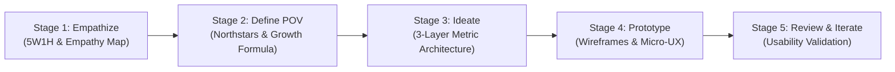

---

### Stage 1: Empathize — Stakeholder Discovery & Context
In Stage 1, we immersed ourselves in the operating cadence of the **Senior Marketing Manager** and **Sales Director** to inventory their decision rhythms, analytical friction points, and data accessibility constraints.

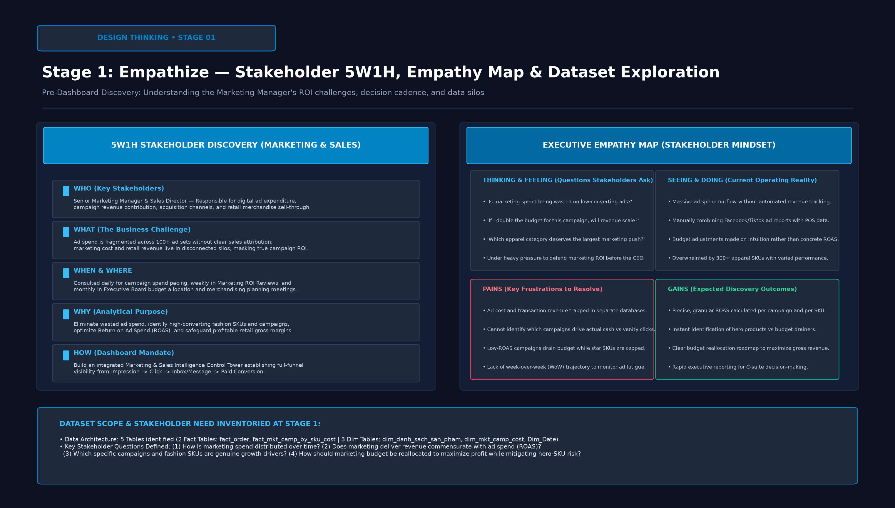

#### 1. 5W1H Stakeholder Analysis
* **WHO (Target User):** Senior Marketing Manager (Primary) and Sales Director (Secondary).
* **WHAT (Core Challenge):** Ad spend is fragmented across dozens of concurrent ad sets with no unified mechanism to connect ad spend with real POS order receipts.
* **WHEN & WHERE:** Consulted daily for real-time campaign spend pacing; weekly during Performance Marketing Reviews; monthly during Executive Board budget planning.
* **WHY (Business Purpose):** Eliminate wasted ad spend, identify high-converting fashion SKUs, optimize Return on Ad Spend (ROAS), and protect operating profit margins.
* **HOW (Dashboard Mandate):** Build an integrated Marketing & Sales Intelligence Control Tower establishing full-funnel visibility from Impressions to completed retail orders.

#### 2. Stakeholder Empathy Map
* **Thinking & Feeling:**
  * *"Is our advertising budget being bled by low-converting ad sets?"*
  * *"If I double the daily budget on this dress campaign, will sales scale proportionally or face diminishing returns?"*
  * *High anxiety defending marketing ROI and budget requests before executive leadership without unified data.*
* **Seeing & Doing:**
  * Manually exporting fragmented ad performance CSVs from Facebook Ads Manager and matching them against retail ERP spreadsheets.
  * Adjusting daily ad budgets based on intuition, vanity CTR, or cost-per-message rather than verified POS sales receipts.
* **Pains (Frustrations to Eliminate):**
  * Marketing spend and transaction revenue live in separate databases with no common attribution key.
  * Information overload across 300+ apparel SKUs makes it difficult to spot star performers.
  * Inability to detect campaign creative fatigue before budget is wasted.
* **Gains (Value to Deliver):**
  * Automated, unified calculation of Blended and SKU-level ROAS.
  * Instant classification of "Hero SKUs" versus "Budget Drainers".
  * Clear, data-backed evidence for budget reallocation to maximize gross revenue.

---

### Stage 2: Define Point of View (POV) — Dual Northstars & Growth Formula
Stage 2 synthesized user empathy into explicit mathematical hypotheses, defining the strategic Northstars and analytical growth equations that govern the entire reporting architecture.

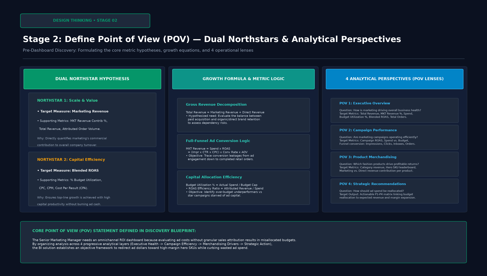

#### 1. Dual Northstar Metrics Hypothesis
* **Northstar 1 (Scale & Commercial Contribution): Marketing Revenue**
  * *Measurement Target:* Total gross sales revenue directly attributed to digital marketing campaigns.
  * *Supporting Metric:* **Marketing Revenue Contribution %** ($\frac{\text{Marketing Revenue}}{\text{Total Revenue}}$).
  * *Strategic Rationale:* Validates marketing's commercial contribution to total enterprise cash flow.
* **Northstar 2 (Capital Efficiency & Financial Return): Return on Ad Spend (ROAS)**
  * *Measurement Target:* Ratio of attributed sales revenue generated per unit of ad currency invested.
  * *Formula:* $\text{ROAS} = \frac{\text{Marketing Revenue}}{\text{Marketing Spend}}$.
  * *Supporting Metric:* **% Budget Utilization** ($\frac{\text{Actual Spend}}{\text{Allocated Budget}}$).
  * *Strategic Rationale:* Guarantees that revenue growth is not driven by reckless, margin-diluting ad spend.

#### 2. Omnichannel Growth Equation
$$\text{Total Retail Revenue} = \text{Marketing Revenue} + \text{Direct / Organic Revenue}$$
$$\text{Marketing Revenue} = \text{Marketing Spend} \times \text{Blended ROAS}$$
$$\text{Marketing Revenue} = (\text{Impressions} \times \text{CTR} \times \text{CPC}) \times \text{Message-to-Order Conversion Rate} \times \text{Average Order Value (AOV)}$$

#### 3. Four Analytical Perspectives (POV Lenses)
* **POV 1: Executive Overview:** Macro business pulse monitoring overall turnover, marketing revenue contribution %, total ad spend, and blended ROAS.
* **POV 2: Campaign Performance:** Tactical ad set evaluation comparing allocated budget vs actual spend and analyzing spend efficiency across campaign types.
* **POV 3: Product Merchandising:** Catalog performance breakdown dissecting category contribution and contrasting paid vs organic revenue per SKU.
* **POV 4: Strategic Recommendations:** Action-oriented synthesis translating diagnostic findings into prioritized P1–P4 operational initiatives.

---

### Stage 3: Ideate — 3-Layer Information Architecture & Layout
To prevent cognitive overload while satisfying both executive scanning and operational deep dives, Stage 3 structured the report according to a **3-Layer Information Hierarchy**.

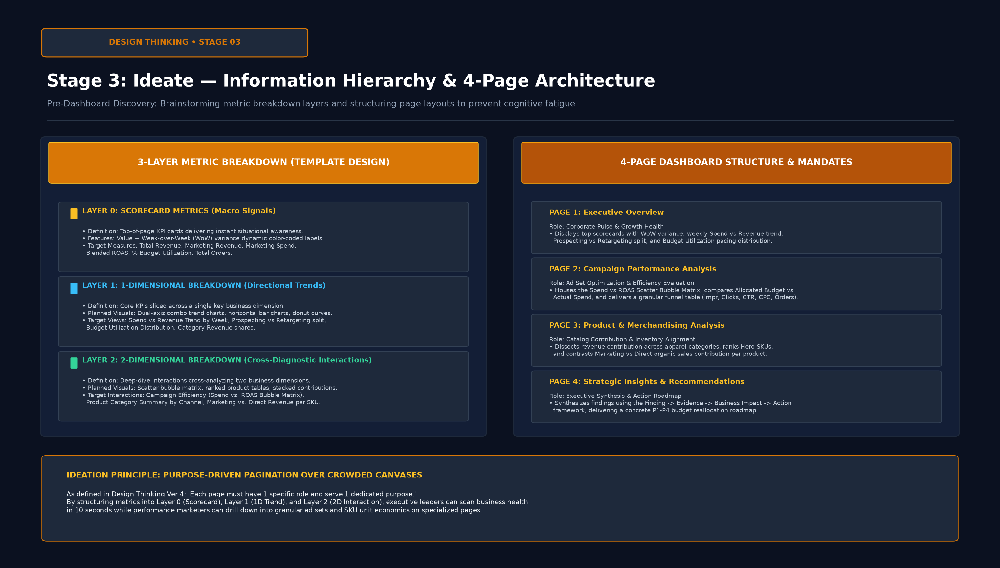

#### 1. 3-Layer Information Hierarchy
* **Layer 0 (Executive Scorecard Signals):** Top-of-canvas KPI cards delivering instant situational awareness with dynamic Week-over-Week (WoW) variance formatting (`Total Revenue`, `MKT Revenue`, `MKT Spend`, `ROAS`, `% Budget Utilization`, `Total Orders`).
* **Layer 1 (1-Dimensional Trend Distribution):** Core metrics sliced across a single key business dimension (Spend vs Revenue trend over weeks, Prospecting vs Retargeting allocation, Budget Utilization distribution).
* **Layer 2 (2-Dimensional Diagnostic Deep Dives):** Advanced cross-dimensional interaction visuals (Spend vs ROAS Scatter Bubble Matrix, SKU-level performance tables, 100% stacked paid vs organic sales contribution).

#### 2. 4-Page Dashboard Functional Mandates
* **Page 1: Executive Overview:** High-level strategic health check for the C-suite and department heads.
* **Page 2: Campaign Performance Analysis:** Ad set optimization workspace for media buyers and performance marketers.
* **Page 3: Product & Merchandising Analysis:** Inventory and merchandising alignment workspace for retail planners.
* **Page 4: Strategic Insights & Recommendations:** Decision-support cockpit synthesizing data into concrete executive actions.

---

### Stage 4: Prototype — Visual Selection Matrix & Wireframing
Stage 4 converted conceptual wireframes into interactive Power BI artifacts, selecting specialized visualization types designed to expose commercial variance instantly.

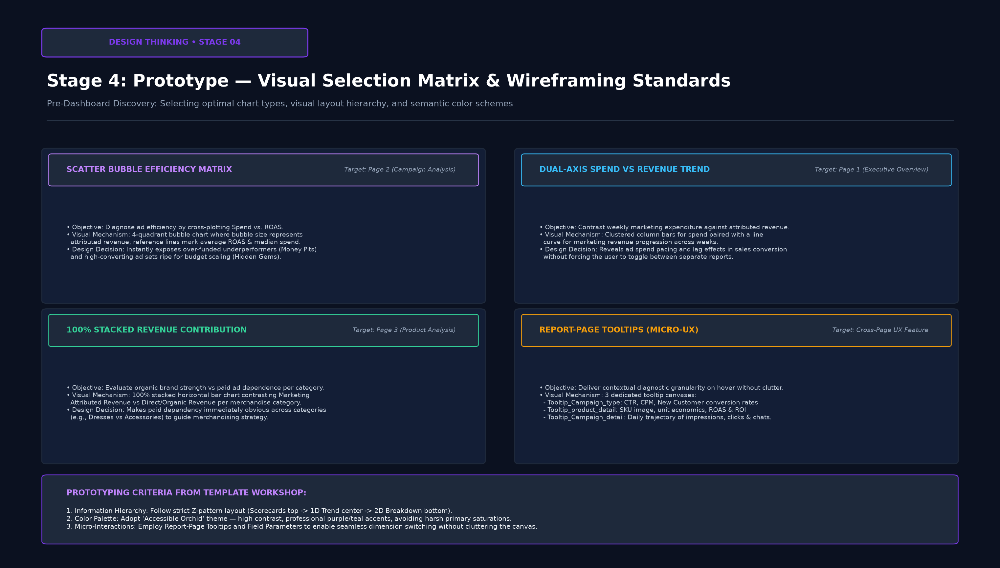

#### 1. Visual Selection Matrix
* **Campaign Efficiency Scatter Bubble Matrix (Page 2):** X-axis: Ad Spend; Y-axis: ROAS; Bubble Size: Attributed Revenue. Categorizes campaigns into 4 actionable quadrants: *Stars (Scale Up)*, *Hidden Gems (Increase Budget)*, *Money Pits (Pause/Restructure)*, and *Watchlist*.
* **Dual-Axis Weekly Trajectory Combo Chart (Page 1):** Clustered columns for ad spend paired with a continuous revenue trend line curve, exposing ad spend lag effects and weekly conversion momentum.
* **100% Stacked Category Contribution Chart (Page 3):** Visualizes the paid vs direct organic revenue split across merchandise categories, evaluating brand equity and marketing dependence.
* **Report-Page Tooltip Canvases (Micro-UX):** Three specialized hover canvases (`Tooltip_Campaign_type`, `Tooltip_product_detail`, `Tooltip_Campaign_detail`) that expose granular unit economics and daily trajectories without cluttering primary page layouts.

#### 2. Design System & Accessibility Standards
* **Theme & Palette:** Configured with Power BI's **Accessible Orchid** design system — utilizing sophisticated dark slate backgrounds, high-contrast lavender/orchid focal accents, and emerald/rose semantic variance indicators.
* **Ergonomics:** Strict Z-pattern layout flow (Macro Scorecards across top $\rightarrow$ Directional Trends in center $\rightarrow$ Granular breakdown tables at bottom).

---

### Stage 5: Review & Iterate — Usability Testing & Refinements
Stage 5 subjected the prototype to rigorous usability audits and stakeholder feedback loops, refining the interface across four major engineering iterations.

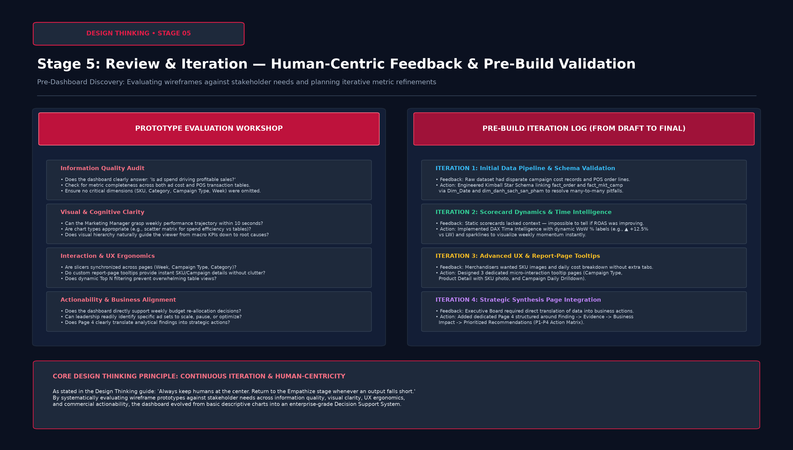

#### Pre-Build Iteration Evolution
1. **Iteration 1 (Data Pipeline & Schema Normalization):** Resolved severe many-to-many attribution risks between daily campaign records and transactional order lines by engineering an analytical Star Schema with conformed Date and Product dimensions.
2. **Iteration 2 (Time Intelligence & Dynamic Context):** Upgraded static scorecards with DAX Time Intelligence, embedding week-over-week (WoW) variance percentages with conditional directional arrows (`▲ +12.5% vs LW`).
3. **Iteration 3 (Micro-Interactions & Drillthrough):** Developed 3 dedicated report-page tooltip canvases enabling instant inspection of SKU imagery, product unit economics, and campaign daily spend pacing upon hover.
4. **Iteration 4 (Executive Synthesis & Strategic Cockpit):** Engineered Page 4 structured around the rigorous **Finding $\rightarrow$ Evidence $\rightarrow$ Business Impact $\rightarrow$ Actionable Recommendation** framework to ensure seamless leadership sign-off.

---

## 🏗️ 3. Data Architecture & Modeling

### 3.1 Data Pipeline & ETL Transformation
The raw dataset (`data/Fashion_Analyst_Dataset.xlsx`) contained multi-source data spanning daily Facebook/digital campaign logs and transactional POS sales receipts. Data transformation in Power Query implemented the following standards:
1. **Attribute Standardization:** Standardized column naming from ad platforms into snake_case and clean business entities.
2. **Attribution Key Engineering:** Linked transactional SKU order lines (`fact_order`) to campaign ad sets (`fact_mkt_camp_by_sku_cost`) using clean foreign keys (`Ma_san_pham` and `Ten_chien_dich`).
3. **Date Harmonization:** Conformed order timestamps and campaign dates to a shared continuous analytical Date Dimension (`Dim_Date`).
4. **Data Integrity & Null Handling:** Filtered out orphaned campaign records, validated zero-cost promotional lines, and normalized currency to VND.

---

### 3.2 Kimball Star Schema Architecture
The data model strictly implements the **Kimball Dimensional Modeling Star Schema**, establishing 1-to-Many (`1:*`) relationships with unidirectional cross-filtering to guarantee optimal DAX calculation performance and prevent ambiguous filter propagation.

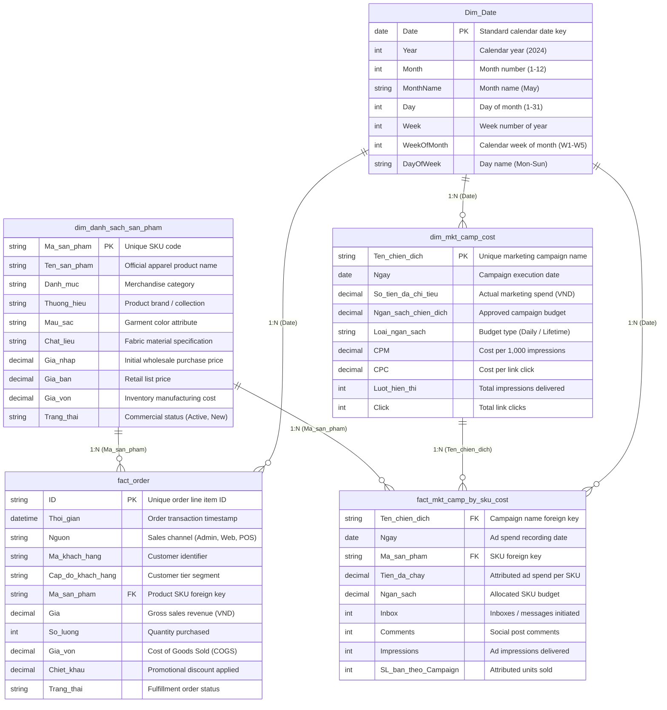

---

### 3.3 Table Summary & Grain Specifications

| Table Name | Table Type | Row Count | Primary Key (PK) | Grain Specification | Analytical Purpose |
| :--- | :---: | :---: | :---: | :--- | :--- |
| **`fact_order`** | Fact Table | 3,651 rows | `ID` | 1 row per individual SKU item purchased within an order. | Computes total retail sales, order quantities, AOV, customer segments, and gross margins. |
| **`fact_mkt_camp_by_sku_cost`** | Fact Table | 3,874 rows | Composite (`Ten_chien_dich` + `Ngay` + `Ma_san_pham`) | 1 row per SKU advertised within a specific ad set per day. | Provides granular product-level advertising cost attribution, message counts, and attributed sales. |
| **`dim_mkt_camp_cost`** | Dimension Table | 1,054 rows | `Ten_chien_dich` + `Ngay` | 1 row per marketing campaign per calendar day. | Evaluates macro campaign metrics: spend pacing, budget caps, CPM, CPC, CTR, and total clicks. |
| **`dim_danh_sach_san_pham`** | Dimension Table | 2,450 rows | `Ma_san_pham` | 1 row per unique apparel SKU. | Enforces merchandise taxonomy, product names, categories, retail prices, and unit costs. |
| **`Dim_Date`** | Dimension Table | 31 rows (May 2024) | `Date` | 1 row per calendar day. | Powers DAX Time Intelligence, Week-over-Week (WoW) variance analysis, and chronological sorting. |

---

### 3.4 Comprehensive Data Dictionary

<details>
<summary><b>📊 1. fact_order (POS Retail Transaction Orders) — Click to expand</b></summary>

| Column Name | Data Type | Constraint | Business Description | Sample Values |
| :--- | :---: | :---: | :--- | :--- |
| `ID` | String | **PK** | Unique identifier for each order transaction line. | `256736016`, `256735911` |
| `Thoi_gian` | DateTime | Not Null | Date and time stamp when the order was completed. | `2024-05-31 23:43:49` |
| `Nguon` | String | Not Null | Origin sales channel of the order. | `Admin`, `Online`, `POS` |
| `Tên khách hàng` | String | Nullable | Full name of the customer placing the order. | `Nguyễn Mai Chi`, `Nga Nguyen` |
| `Mã khách hàng` | String | Nullable | System identifier for the registered customer. | `KH001924`, `KH008812` |
| `Cấp độ khách hàng` | String | Not Null | Loyalty tier classification of the customer. | `Membership`, `VIP Gold`, `Standard` |
| `Sinh nhật` | Date | Nullable | Date of birth for demographic profiling. | `18/11/1986`, `10/09/1990` |
| `Thành phố` | String | Not Null | Shipping destination province / city. | `Hà Nội`, `TP Hồ Chí Minh`, `Đà Nẵng` |
| `Quận huyện` | String | Not Null | District name for regional delivery analysis. | `Quận Hai Bà Trưng`, `Quận Hoàng Mai` |
| `Phường xã` | String | Nullable | Ward name for hyper-local delivery mapping. | `Phường Minh Khai`, `Phường Giáp Bát` |
| `Sản phẩm` | String | Not Null | Full merchandise product title with size variant. | `*Malina Skirt - XS`, `*Azura Dress 2 - S` |
| `Mã sản phẩm cha` | String | Not Null | Parent style code grouping product sizes. | `THMLSK001_BM`, `HEARDR002_HO` |
| `Tên sản phẩm cha` | String | Not Null | Standardized parent product name. | `*Malina Skirt`, `*Azura Dress 2` |
| `Mã sản phẩm` | String | **FK** | Unique SKU code linking to Product Dimension. | `THMLSK001_BM-XS`, `HEARDR002_HO-S` |
| `Mã vạch` | String | Nullable | Barcode EAN for POS scanner verification. | `2000210208027`, `2000214247466` |
| `Danh mục sản phẩm` | String | Not Null | Apparel merchandise classification. | `Chân Váy Tách Set`, `Váy Chiết Eo Xoè` |
| `Chiết khấu` | Decimal | Nullable | Discount amount deducted from retail price (VND). | `0.0`, `200000.0` |
| `Giá` | Decimal | Not Null | Net transaction price paid by customer (VND). | `880000.0`, `1700000.0` |
| `Số lượng` | Integer | Not Null | Unit quantity ordered in the transaction line. | `1`, `2` |
| `Giá vốn` | Decimal | Not Null | Cost of Goods Sold (COGS) for the line item (VND). | `1080000.0`, `1270000.0` |
| `Trạng thái` | String | Not Null | Fulfillment and delivery status of the order. | `Đang xác nhận`, `Hoàn thành`, `Đã hủy` |
| `Lý do hủy` | String | Nullable | Recorded reason in case of order cancellation. | `Khách đổi ý`, `Hết size` |
</details>

<details>
<summary><b>📈 2. fact_mkt_camp_by_sku_cost (SKU-Level Marketing Cost Attribution) — Click to expand</b></summary>

| Column Name | Data Type | Constraint | Business Description | Sample Values |
| :--- | :---: | :---: | :--- | :--- |
| `Tên chiến dịch` | String | **FK** | Marketing campaign name linking to Campaign Dim. | `TH 25/4 ELEGANT AESTHETICS LAL new` |
| `Ngày` | Date | **FK** | Performance recording date linking to Date Dim. | `2024-05-01`, `2024-05-15` |
| `Đơn vị tiền tệ` | String | Not Null | Currency denomination for ad spend tracking. | `VND` |
| `Số tiền đã chi tiêu (VND)`| Decimal | Not Null | Aggregate ad spend for the campaign on that date. | `324287.0`, `500000.0` |
| `Phân phối chiến dịch` | String | Not Null | Delivery status on advertising platform. | `active`, `paused` |
| `Ngân sách chiến dịch` | Decimal | Not Null | Target budget cap allocated for the campaign. | `500000.0`, `1000000.0` |
| `Loại ngân sách chiến dịch`| String | Not Null | Budget allocation schedule type. | `Daily`, `Lifetime` |
| `Lần bắt đầu cuộc trò chuyện`| Integer | Not Null | Count of messaging conversations started via ads. | `4`, `12` |
| `Bình luận về bài viết` | Integer | Nullable | Total user comments left on the promoted post. | `0`, `5` |
| `CPM` | Decimal | Not Null | Cost per 1,000 ad impressions (VND). | `63836.02`, `99596.0` |
| `CPC` | Decimal | Not Null | Cost per link click (VND). | `13511.96`, `21520.0` |
| `CTR` | Decimal | Not Null | Click-through rate percentage. | `0.0047` (0.47%), `0.012` |
| `Tin nhắn mới` | Integer | Not Null | Inquiries initiated from first-time prospect users. | `1`, `6` |
| `Lượt hiển thị` | Integer | Not Null | Total ad impressions delivered. | `5080`, `12450` |
| `Mã Sản phẩm` | String | **FK** | Advertised SKU code linking to Product Dimension. | `HELSDR001_DT`, `HEMIDR001_LC` |
| `Tên Sản Phẩm` | String | Not Null | Commercial merchandise title of the SKU. | `*Luisa Dress`, `**Mimei Dress` |
| `Giá bán` | Decimal | Not Null | Listed retail sales price of the SKU (VND). | `1550000.0`, `1800000.0` |
| `Tiền đã chạy Theo Sản phẩm`| Decimal | Not Null | Fractional ad spend mathematically attributed to SKU. | `23163.35`, `85400.0` |
| `Ngân sách Theo sản phẩm` | Decimal | Not Null | Fractional budget cap assigned to the individual SKU. | `35714.28`, `125000.0` |
| `Inbox Theo AM` | Decimal | Not Null | Attributed inbox inquiries weighted to SKU. | `0.285`, `1.50` |
| `Comments Theo AM` | Decimal | Not Null | Attributed user comments weighted to SKU. | `0.0`, `2.1` |
| `SL bán tổng` | Decimal | Not Null | Total units sold across all channels during campaign. | `0.0`, `4.0` |
| `SL tồn` | Integer | Not Null | Current warehouse inventory available for fulfillment. | `12`, `1`, `45` |
| `Tổng SL bán theo Campaign`| Decimal | Not Null | Directly converted sales units credited to campaign. | `1.0`, `5.0` |
</details>

<details>
<summary><b>🎯 3. dim_mkt_camp_cost (Campaign Daily Aggregates) — Click to expand</b></summary>

| Column Name | Data Type | Constraint | Business Description | Sample Values |
| :--- | :---: | :---: | :--- | :--- |
| `Tên chiến dịch` | String | **PK** | Official marketing ad set title. | `TH 5.5 NEW ARRIVAL - ib - Op -1000k` |
| `Ngày` | Date | **PK** | Ad delivery date linking to Date Dimension. | `2024-05-07`, `2024-05-20` |
| `Số tiền đã chi tiêu` | Decimal | Not Null | Total actual spend consumed by campaign (VND). | `332849.0`, `318070.0` |
| `Phân phối chiến dịch` | String | Not Null | Active ad delivery state. | `active`, `completed` |
| `Ngân sách chiến dịch` | Decimal | Not Null | Approved daily or lifetime spend cap (VND). | `500000.0`, `1500000.0` |
| `Loại ngân sách chiến dịch`| String | Not Null | Budget structure designation. | `Daily`, `Lifetime` |
| `CPM` | Decimal | Not Null | Blended cost per thousand impressions. | `99596.0`, `74200.0` |
| `CPC` | Decimal | Not Null | Cost per verified link click. | `21520.0`, `10707.0` |
| `Lượt hiển thị` | Integer | Not Null | Total audience view impressions. | `3342`, `8920` |
| `Click` | Integer | Not Null | Total outbound link clicks registered. | `15`, `30`, `112` |
</details>

<details>
<summary><b>👗 4. dim_danh_sach_san_pham (Product Master Catalog) — Click to expand</b></summary>

| Column Name | Data Type | Constraint | Business Description | Sample Values |
| :--- | :---: | :---: | :--- | :--- |
| `ID` | String | Not Null | Internal catalog SKU surrogate ID. | `40770035`, `40770030` |
| `Mã vạch` | String | Nullable | EAN-13 barcode identification. | `2000214250213`, `2000214250169` |
| `Loại sản phẩm` | String | Not Null | Product type category. | `Sản phẩm`, `Phụ kiện` |
| `Mã sản phẩm` | String | **PK** | Unique apparel SKU primary key. | `HEMLDR001_LA`, `HEGLDR001_DT` |
| `Tên sản phẩm` | String | Not Null | Formal consumer title of apparel product. | `*Matina Dress`, `*Galina Dress` |
| `Giá nhập` | Decimal | Not Null | Raw procurement / manufacturing cost (VND). | `1285000.0`, `1295000.0` |
| `Giá bán` | Decimal | Not Null | Standard retail list price before tax (VND). | `1600000.0`, `1550000.0` |
| `Giá bán + VAT` | Decimal | Not Null | Consumer retail price including sales tax (VND). | `1600000.0`, `1550000.0` |
| `Giá vốn` | Decimal | Not Null | Standardized inventory valuation COGS (VND). | `1290000.0`, `1450000.0` |
| `Trạng thái` | String | Not Null | Lifecycle commercial status. | `Mới`, `Bán chạy`, `Ngừng KD` |
| `Mã danh mục` | String | Not Null | Categorical short code. | `VCEX001`, `SMN002` |
| `Danh mục` | String | Not Null | Official apparel department classification. | `Váy Chiết Eo Xoè`, `Áo Sơ Mi`, `Quần Tây` |
| `Mã danh mục nội bộ` | String | Nullable | Internal merchandising collection tag. | `HE_Đi làm đi chơi`, `HE_Tiệc` |
| `Thương hiệu` | String | Not Null | Apparel sub-brand or collection line. | `Hoa`, `La Lune`, `Basic` |
| `Màu sắc` | String | Not Null | Garment color scheme. | `Xanh Lá`, `Mixed Color`, `Trắng` |
| `Chất liệu` | String | Nullable | Textile fabric composition. | `Tơ`, `Lụa Hàn`, `Cotton poplin` |
</details>

<details>
<summary><b>📅 5. Dim_Date (Analytical Calendar Dimension) — Click to expand</b></summary>

| Column Name | Data Type | Constraint | Business Description | Sample Values |
| :--- | :---: | :---: | :--- | :--- |
| `Date` | Date | **PK** | Calendar date key in continuous sequence. | `2024-05-01`, `2024-05-31` |
| `Year` | Integer | Not Null | Calendar reporting year. | `2024` |
| `Month` | Integer | Not Null | Month number (1 to 12). | `5` |
| `MonthName` | String | Not Null | Full month name string. | `May` |
| `Day` | Integer | Not Null | Calendar day of month (1 to 31). | `1`, `15`, `31` |
| `Week` | Integer | Not Null | ISO calendar week number of year. | `18`, `19`, `20`, `21`, `22` |
| `WeekOfMonth` | Integer | Not Null | Reporting week cycle within the month. | `1`, `2`, `3`, `4`, `5` |
| `DayOfWeek` | String | Not Null | Text name for day of week. | `Monday`, `Friday`, `Sunday` |
</details>

---

## 📊 4. Interactive Dashboard Architecture & Visuals

The Power BI report is organized into **4 Analytical Pages** and **3 Specialized Micro-Interaction Tooltips**, engineered to guide stakeholders seamlessly from high-level corporate health to operational root-cause diagnostics.

```
Interactive Dashboard Architecture:
├── Page 1: Executive Overview (Corporate Pulse & Growth Trajectory)
├── Page 2: Campaign Performance Analysis (Ad Set Efficiency & Scatter Matrix)
├── Page 3: Product & Merchandising Analysis (Catalog Performance & Paid vs Organic Split)
├── Page 4: Strategic Insights & Recommendations (Finding -> Evidence -> Impact -> Action)
└── Micro-UX Tooltip Canvases:
    ├── Tooltip_Campaign_type (Funnel metrics: CTR, CPM, New Customer Rate)
    ├── Tooltip_product_detail (SKU Photo, Unit Economics, ROAS & ROI)
    └── Tooltip_Campaign_detail (Daily Trajectory: Impressions, Clicks, Inquiries)
```

---

### Page 1: Executive Overview
* **Target Audience:** Chief Executive Officer (CEO), Senior Marketing Manager, Sales Director.
* **Core Analytical Mandate:** Provide an instant 10-second pulse check on total business health, marketing turnover contribution, budget pacing, and capital return.
* **Key Visuals & Chart Selection Rationale:**
  * **Top Executive Scorecards (Layer 0):** Six high-impact cards with dynamic Week-over-Week (WoW) labels: `Total Revenue` (4.77B VND), `Marketing Spend` (394M VND), `Marketing Revenue by Orders` (3.02B VND), `Blended ROAS` (7.67x), `Marketing Revenue Contribution %` (63.3%), and `Total Orders` (2,858).
  * **Marketing Performance Trend (Layer 1):** Dual-axis combo chart plotting weekly Ad Spend (columns) against Attributed Marketing Revenue (line) to detect lag effects and spend pacing.
  * **Prospecting vs Retargeting Snapshot:** Clustered bar chart contrasting top-of-funnel customer acquisition vs remarketing efficiency.
  * **Budget Utilization Distribution:** Ribbon/Gauge visual tracking actual spend pacing against allocated monthly caps.

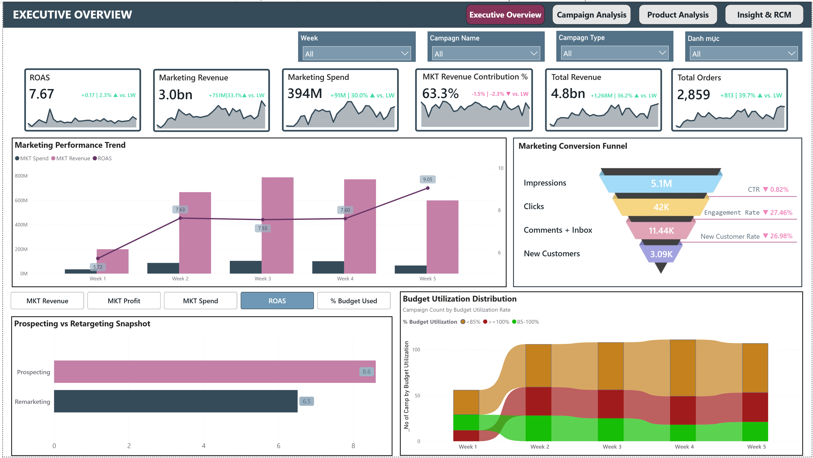

---

### Page 2: Campaign Performance Analysis
* **Target Audience:** Senior Marketing Manager, Media Buyers, Performance Marketers.
* **Core Analytical Mandate:** Dissect individual ad set performance, eliminate budget waste, and identify scalable campaigns.
* **Key Visuals & Chart Selection Rationale:**
  * **Campaign Efficiency Scatter Bubble Matrix (Layer 2):** X-axis: Ad Spend; Y-axis: ROAS; Bubble Size: Attributed Revenue. Categorizes campaigns into 4 actionable quadrants: *Stars (Scale Up)*, *Hidden Gems (Increase Budget)*, *Money Pits (Pause/Restructure)*, and *Watchlist*.
  * **Marketing Budget Performance:** Comparison of allocated budget vs actual spend to spot over-budget pacing.
  * **Granular Campaign Performance Table:** Detailed attribution matrix listing Impressions, Clicks, CTR, CPC, Inboxes/Comments, Orders, Spend, Revenue, and ROAS.

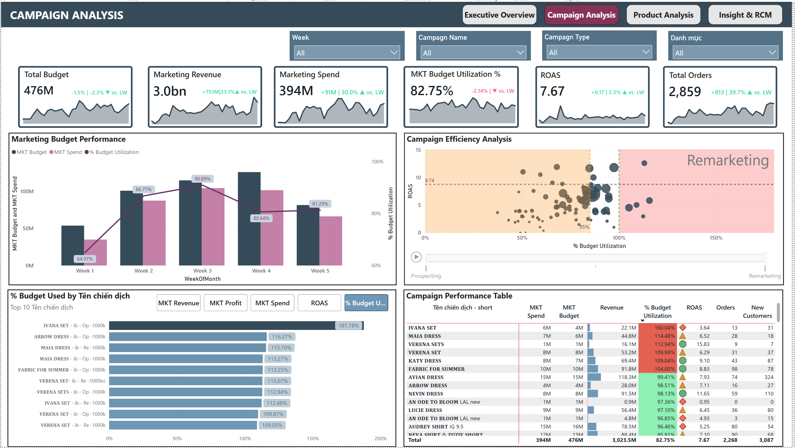

---

### Page 3: Product & Merchandising Analysis
* **Target Audience:** Sales Director, Merchandise Planners, Inventory Managers.
* **Core Analytical Mandate:** Align marketing ad dollars with inventory availability and identify which fashion SKUs drive genuine commercial profitability.
* **Key Visuals & Chart Selection Rationale:**
  * **Hero SKU Leaderboard (Layer 1):** Ranked horizontal bar visual highlighting top revenue-driving fashion products (`Audrey Shirt`, `Lisa Dress`, `Avian Dress`, `Kino Dress`).
  * **Product Category Performance Matrix:** Breakdown across Dresses (`Váy Chiết Eo Xoè`), Shirts (`Áo Sơ Mi`), Pants (`Quần Tây`), and Accessories.
  * **Marketing vs Direct Revenue Contribution (Layer 2):** 100% stacked bar chart revealing the paid ad dependency versus organic brand pull for each category.
  * **Dynamic Field Parameter Slicer:** Allows merchandisers to dynamically switch visual dimensions between Product Category, Sub-Category, and Collection Line.

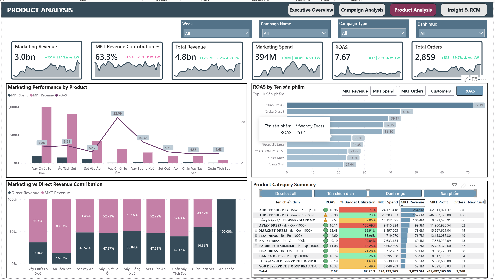

---

### Page 4: Strategic Insights & Recommendations
* **Target Audience:** C-Suite Leadership, Marketing & Sales Department Heads.
* **Core Analytical Mandate:** Directly bridge the gap between business intelligence and executive decision-making using the standardized **Finding $\rightarrow$ Evidence $\rightarrow$ Business Impact $\rightarrow$ Actionable Recommendation** framework.

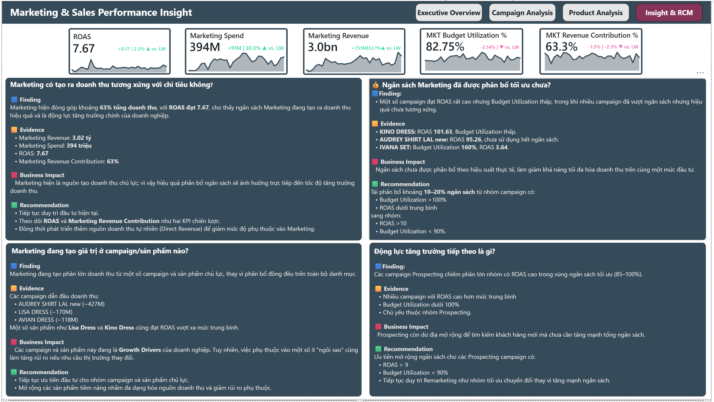

---

### Micro-Interactions & Report-Page Tooltips
To preserve clean visual layouts while enabling instant diagnostic deep dives, three custom report-page tooltips were implemented:
1. **`Tooltip_Campaign_type`:** Activates when hovering over campaign category visuals; displays CTR %, CPM, Total Customers, and New Customer Contribution curves.
2. **`Tooltip_product_detail`:** Activates on SKU leaderboard visuals; renders the apparel product thumbnail image, unit price, COGS, profit margin, ROAS, and ROI.
3. **`Tooltip_Campaign_detail`:** Activates on campaign matrix rows; displays the day-by-day trajectory of ad impressions, link clicks, comments, and private message inquiries.

---

## 💡 5. In-Depth Business Insights & Evidence

### Insight 1: Marketing is the Primary Growth Engine with High Capital Efficiency
* **Finding:** Digital advertising is not a discretionary overhead cost; it is the fundamental commercial growth engine of the fashion retail enterprise, generating nearly two-thirds of total business revenue while operating at exceptional capital productivity.
* **Empirical Evidence:**
  * **Marketing Revenue:** **3.02 Billion VND**, accounting for **63.3%** of total gross company turnover (4.77 Billion VND).
  * **Total Ad Spend:** **394 Million VND** deployed across digital channels.
  * **Blended ROAS:** **7.67x**, exceeding the standard fashion retail e-commerce viability benchmark of 4.0x by **+91.8%**.
  * **Attributed Orders:** Drove 1,800+ completed transactions out of 2,858 total store orders.
* **Analytical Interpretation & Business Impact:** Digital marketing expenditure demonstrates strong pricing power and high conversion efficiency. Any arbitrary reduction in marketing budget would directly impair total company revenue and operating cash flow.

---

### Insight 2: Severe Revenue Concentration in a Small Basket of "Hero SKUs"
* **Finding:** Commercial revenue exhibits extreme Pareto concentration: over 23.7% of all marketing revenue and 45%+ of high-ROAS returns are generated by a tiny cluster of "Hero Products," exposing the enterprise to severe inventory and creative fatigue risks.
* **Empirical Evidence:**
  * Top 3 revenue-generating ad campaigns:
    * `AUDREY SHIRT LAL new`: **~427 Million VND** attributed revenue (ROAS 95.26x).
    * `LISA DRESS`: **~170 Million VND** attributed revenue.
    * `AVIAN DRESS`: **~118 Million VND** attributed revenue.
  * Star SKUs like **Lisa Dress** and **Kino Dress** achieved individual ROAS exceeding 100x, while hundreds of long-tail apparel SKUs generated negligible ad returns.
* **Analytical Interpretation & Business Impact:** High reliance on 3–4 hero styles creates catastrophic supply chain vulnerability: if stockouts occur on *Audrey Shirt* or *Lisa Dress*, or if consumer aesthetic preferences shift, company-wide revenue will drop precipitously.

---

### Insight 3: Capital Allocation Mismatch — High-ROAS Underfunded vs Over-Budget Bleeders
* **Finding:** Ad budget deployment is misaligned with commercial performance: several exceptional high-ROAS campaigns remain severely underfunded (Budget Utilization < 90%), while low-performing campaigns have exceeded their budget caps (>100% to 160%) without delivering proportional returns.
* **Empirical Evidence:**
  * **Underfunded Star Campaigns:**
    * `KINO DRESS`: ROAS **101.63x**, yet operated with low daily budget utilization.
    * `AUDREY SHIRT LAL new`: ROAS **95.26x**, yet failed to consume its allocated monthly cap.
  * **Over-Budget Underperformers:**
    * `IVANA SET`: Budget Utilization reached **160%** (severe budget overrun), yet yielded a meager ROAS of **3.64x** (hovering near break-even after COGS and fulfillment costs).
* **Analytical Interpretation & Business Impact:** Capital is trapped in low-margin, decaying ad sets while high-margin, viral SKUs are starved of ad dollars. Rebalancing capital will unlock incremental gross profit without increasing overall marketing expenditure.

---

### Insight 4: Significant Scalable Headroom in Prospecting Acquisition Funnels
* **Finding:** Top-of-funnel Prospecting campaigns dominate the cohort of high-ROAS performers within the optimal budget utilization corridor (85–100%), demonstrating that the business has substantial untapped headroom to acquire new customers without exhausting market saturation limits.
* **Empirical Evidence:**
  * Prospecting ad sets consistently generated ROAS > 9.0x while maintaining Budget Utilization < 90%.
  * Remarketing / Retargeting campaigns achieved excellent conversion efficiency and low CPA, but their scale is structurally constrained by the existing pool of website visitors and social engagers.
* **Analytical Interpretation & Business Impact:** The enterprise does not need to inflate total company ad spend to grow. By expanding prospecting budgets within proven creative angles, the brand can widen the top of the funnel, feed retargeting audiences, and drive sustainable top-line expansion.

---

## 🚀 6. Prioritized Strategic Action Matrix

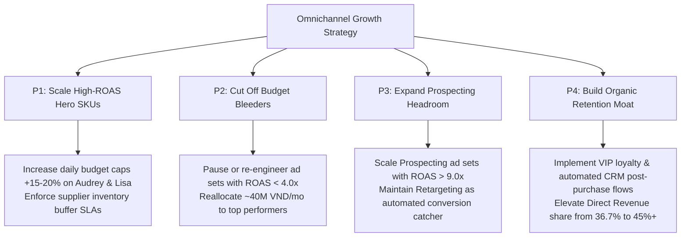

| Priority | Strategic Initiative | Target Area / Owner | Concrete Action Items | Expected Business Impact & Target KPI |
| :---: | :--- | :---: | :--- | :--- |
| **P1**<br/>Immediate | **Scale Budget Caps on Hero SKUs & Secure Inventory Buffer** | Performance Marketing & SCM Planners | • Increase daily spend caps by **15–20%** on `AUDREY SHIRT LAL new`, `LISA DRESS`, and `KINO DRESS`.<br/>• Establish a minimum 3-week inventory buffer SLA with garment manufacturers to prevent stockouts during peak ad scaling. | • Capture an estimated **+250M–350M VND** incremental monthly revenue while maintaining ROAS > 8.0x.<br/>• Eliminate lost sales from hero SKU stockouts. |
| **P2**<br/>Short Term | **Prune Budget Overruns on Low-ROAS Campaigns** | Media Buyers & Ad Operations | • Immediately pause or re-engineer ad sets with ROAS < 4.0x and Budget Utilization > 100% (e.g., `IVANA SET`).<br/>• Enforce automated ad spend rules capping ad sets that exceed target Cost Per Message. | • Reallocate **~40M–60M VND/month** of wasted ad spend directly into proven high-converting creative sets.<br/>• Expand blended retail operating margin by **+2.5%**. |
| **P3**<br/>Medium Term | **Scale Prospecting Acquisition Headroom** | Growth Marketing Team | • Prioritize budget expansion for Prospecting campaigns demonstrating ROAS > 9.0x and Budget Utilization < 90%.<br/>• Restrict Retargeting spend to an automated conversion catcher (capped at 15–20% of total budget). | • Expand the top-of-funnel customer pool, generating **+15% new customer acquisition** without increasing blended CPA. |
| **P4**<br/>Long Term | **Build Organic Retention & VIP Loyalty Moat** | CRM & E-Commerce Operations | • Launch automated post-purchase email/SMS workflows (welcome sequences, review incentives, cross-sell recommendations).<br/>• Establish a VIP tiered loyalty program to drive repeat purchases among the existing 2,800+ buyer base. | • Elevate Direct/Organic revenue contribution from **36.7% to 45%+**, reducing single-channel dependency on paid Meta ads. |

---

## 🧮 7. Advanced DAX Formula Engineering

Below is a curated selection of enterprise-grade DAX measures implemented in the Power BI model, adhering to clean architecture, explicit filter context management (`CALCULATE`), and descriptive variable formatting (`VAR/RETURN`).

### 1. Return on Ad Spend (ROAS)
Calculates capital efficiency by dividing attributed marketing revenue by actual digital ad spend, protected against division-by-zero errors.
```dax
ROAS = 
VAR _MktRevenue = [MKT Revenue by Camp]
VAR _MktSpend = [MKT Spend]
RETURN
    DIVIDE(
        _MktRevenue,
        _MktSpend,
        0
    )
```

---

### 2. Marketing Revenue Contribution Percentage
Measures the proportion of total enterprise turnover generated by digital marketing campaigns.
```dax
MKT Revenue Contribution % = 
VAR _MktRevenue = [MKT Revenue by Camp]
VAR _TotalRevenue = [Total Revenue]
RETURN
    DIVIDE(
        _MktRevenue,
        _TotalRevenue,
        0
    )
```

---

### 3. Budget Utilization Rate
Monitors ad spend pacing by comparing actual expenditure against approved budget caps.
```dax
% Budget Utilization = 
VAR _ActualSpend = [MKT Spend]
VAR _AllocatedBudget = [MKT Budget]
RETURN
    DIVIDE(
        _ActualSpend,
        _AllocatedBudget,
        0
    )
```

---

### 4. Week-over-Week (WoW) Marketing Spend Variance (Time Intelligence)
Computes the percentage shift in advertising expenditure compared to the preceding 7-day calendar cycle.
```dax
MKT Spend vs LW % = 
VAR _CurrentSpend = [MKT Spend]
VAR _LastWeekSpend = 
    CALCULATE(
        [MKT Spend],
        DATEADD('Dim_Date'[Date], -7, DAY)
    )
RETURN
    DIVIDE(
        _CurrentSpend - _LastWeekSpend,
        _LastWeekSpend,
        0
    )
```

---

### 5. Dynamic KPI Card Formatted Label (UX Enhancement)
Generates dynamic Unicode formatted strings for executive scorecards, automatically rendering directional variance indicators and percentage deltas.
```dax
MTK ROAS Label WoW = 
VAR _VarPct = [MKT ROAS vs LW %]
RETURN
    IF(
        ISBLANK(_VarPct),
        "- vs LW",
        IF(
            _VarPct >= 0,
            "▲ +" & FORMAT(_VarPct, "0.0%") & " vs LW",
            "▼ " & FORMAT(_VarPct, "0.0%") & " vs LW"
        )
    )
```

---

## 📁 8. Repository Structure & How to Reproduce

### Repository Directory Tree
```
powerbi-fashion-retail-marketing-analytics/
├── assets/
│   ├── dashboards/               # High-resolution dashboard screenshots
│   │   ├── 01_Executive_Overview.png
│   │   ├── 02_Campaign_Analysis.png
│   │   ├── 03_Product_Analysis.png
│   │   ├── 04_Insight_Recommendations.png
│   │   └── Fashion_Retail_Marketing_Performance_Analytics.pdf
│   └── framework/                # Generated Design Thinking visual infographics (Stages 1-5)
│       ├── generate_all_stages.py
│       ├── stage_1_empathize.png
│       ├── stage_2_define_pov.png
│       ├── stage_3_ideate.png
│       ├── stage_4_prototype.png
│       └── stage_5_review_iterate.png
├── data/
│   ├── data_dictionary.md        # Supplementary table and schema documentation
│   └── Fashion_Analyst_Dataset.xlsx # Sanitized source transactional & campaign dataset
├── docs/
│   ├── Design Thinking.xlsx      # Official user-centric Design Thinking blueprint workbook
│   └── design_thinking_framework.md # 5W1H, Empathy map, and Growth Formula documentation
├── pbix/
│   └── Fashion_Retail_Marketing_Performance_Analytics.pbix # Official production Power BI Desktop model
├── .gitignore                    # Excludes backups, caches, and local configurations
└── README.md                     # Comprehensive Master Portfolio Documentation
```

---

### How to Reproduce & Open the Project
1. **Clone this repository to your local machine:**
   ```bash
   git clone https://github.com/thunx280-ctrl/powerbi-fashion-retail-marketing-analytics.git
   ```
2. **Open the Power BI Report:**
   * Double-click `pbix/Fashion_Retail_Marketing_Performance_Analytics.pbix` (Requires [Power BI Desktop](https://powerbi.microsoft.com/desktop/) May 2024 version or later).
3. **Data Source Configuration (if required):**
   * If Power BI prompts to update data paths:
     1. Navigate to **Home $\rightarrow$ Transform Data $\rightarrow$ Data source settings**.
     2. Select `Fashion_Analyst_Dataset.xlsx` and click **Change Source**.
     3. Point the path to the localized `data/Fashion_Analyst_Dataset.xlsx` within your cloned repository folder.
     4. Click **Apply Changes** to refresh queries.

---

## 👤 9. Author & Contact

* **Author:** **Nguyễn Xuân Thu**
* **Role:** Data Analyst / Business Intelligence Specialist
* **Specialization:** E-Commerce Growth Analytics, Marketing Attribution Modeling, Retail Merchandising BI
* **Email:** [thu.nx280@gmail.com](mailto:thu.nx280@gmail.com)
* **LinkedIn:** [https://linkedin.com/](https://linkedin.com/)
* **GitHub:** [https://github.com/thunx280-ctrl](https://github.com/thunx280-ctrl)
* **Project Repository:** [powerbi-fashion-retail-marketing-analytics](https://github.com/thunx280-ctrl/powerbi-fashion-retail-marketing-analytics)

---
*⭐ If you find this business intelligence project insightful for your business, research, or hiring evaluation, please consider starring this repository!*
